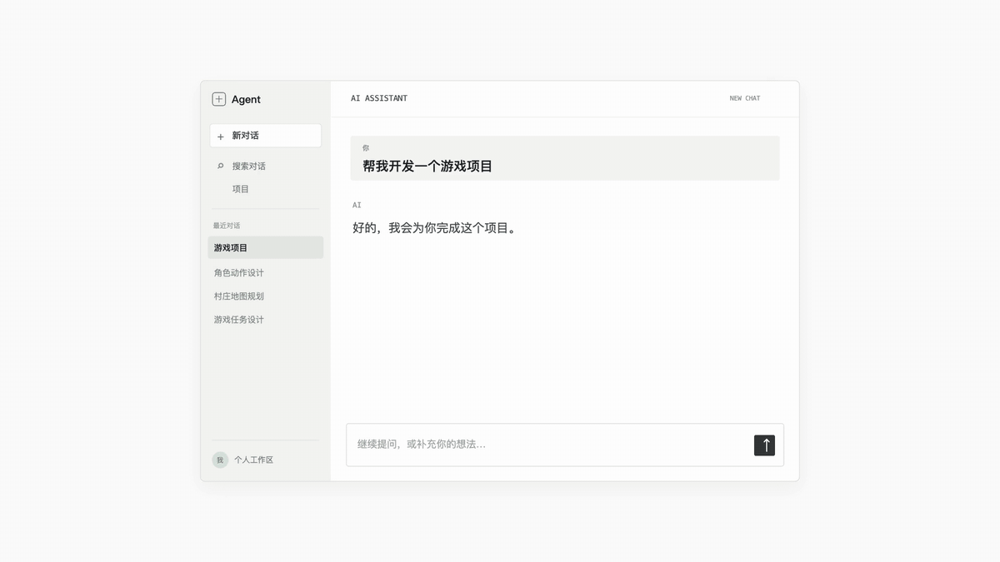

<p align="center">
  
</p>

<h1 align="center">Blueprint 蓝图</h1>

<p align="center">
  <b>Give it a goal. Watch an organization grow.</b><br>
  给它一个目标，看一个组织长出来。
</p>

<p align="center">
  可视化的多 Agent 协作系统。一句话长成一支 AI 团队：定计划、分工、动手、把成果接成一个整体。整个过程画在一张实时的图纸上，你随时能看、能插手。
</p>

<p align="center">
  <a href="https://github.com/wbohui123-sys/blueprint/releases/latest"></a>
  
  <a href="mailto:wbohui123@gmail.com"></a>
</p>

<p align="center">
  <a href="README.md">English</a> · 中文
</p>

<p align="center">
  
</p>

## 它做什么

你写一句话，Blueprint 长出一支团队来做：

- **总制作人**先弄清你到底要什么，把整件事分成几个阶段。
- 每个阶段交给一位**统筹负责人**，它再分成几块，给每块搭好干活的地方。
- 还大的块，再交给下一层的负责人；本身是一个整体的块，交给**专项执行者**一口气做完。
- 成果一层层交回来，接成一份完整的成品。

没有固定岗位，也不用你画流程图。团队长成什么样，由这件事决定：做游戏会长出美术、战斗、关卡、声音；写报告会长出调研、数据、写作。

而且你全看得见。每个 Agent 都是图纸上的一张卡片：在做什么、卡在哪、做出了什么、汇报了什么。点开任何一个，就能看它的成果、直接对它说话。

## 同一句话，不同做法

每个游戏都从同一句话开始，原样交给每一组。

**俯视角射击割草、塔防**

https://github.com/user-attachments/assets/07f0aff9-cf56-4184-857f-eccb1f542617

**类魂 Boss 战**

https://github.com/user-attachments/assets/a61b1c01-2455-4620-81ce-e13bd3cfa7ee

| 花费（美元） | DeepSeek harness + DeepSeek v4.1 | Codex + GPT-6.1 Sol | Blueprint + DeepSeek v4.1 | Blueprint + DeepSeek 指挥 Codex + GPT-6.1 Sol |
| --- | --- | --- | --- | --- |
| 俯视角射击割草 | $0.45 | — | $6.43 † | — |
| 塔防 | $0.39 | — | $5.20 † | — |
| 类魂 Boss 战 | $0.40 | 约 $3–4（预估） | $6.03 | $37.84 † |

<sub>DeepSeek 按低谷价算，按 ¥7.1 = $1 换算。† 中途截断，只算到截断那一刻。</sub>

<details>
<summary>三句 prompt 原话</summary>

- **俯视角射击割草：** 结合游戏“僵尸毁灭工程”融合游戏“暗黑刷宝”做一个俯视角 30射击割草爽游。夜晚开放停车场场景，氛围感极强，强特效，强喜忌，强射击爽感，强美术效果。
- **塔防：** 做一个超高美术风格效果的星际风格塔防游戏，写实像素质感，超丰富细节，超丰富特效，超有氛围感沉浸感，
- **类魂 Boss 战：** 创造一个类似恶魔之魂史诗级 boss 战的一个场景，要求非常辉煌大气，极强有压迫感的环境氛围与音乐，极致细腻的史诗级敌人建模，看到就有强烈的敬畏感，夸张的动作与英文台词，主角渺小且只能使用有限的攻击手段。主要追求极强的关卡美术设计，氛围感，史诗感，华丽感。（室外关卡）

</details>

## 功能

- **实时图纸**：整支团队在一张图上，颜色就是状态：在跑、在等、等你、做完了。可以切换看每一轮、每个阶段。
- **随时插手**：对任何一个 Agent 说话；只停一个，其余照跑；某一个可以重来，改动留着或清掉都行。
- **参与多少你定**：全交给你们、只验收结果、一起做、深度参与，做到一半也能换。
- **每个 Agent 有自己的工作区**：自己的 Git 分支，只拿到自己那一块，还带着检查自己这块的工具；做完再并回去。
- **干活的可以换人**：Agent 用你接上的任何模型；大块的活也能交给你电脑上的 Codex 或 Claude Code。
- **需要什么接什么**：二十多份 skill（Godot、Blender、Three.js、Phaser、FFmpeg、Word／Excel／PowerPoint 等）、图片／视频／音频 API，本机软件一键安装。

## 开始用

1. 从 [Releases](https://github.com/wbohui123-sys/blueprint/releases/latest) 下载最新的 `.dmg`。暂时只支持 Apple 芯片的 Mac。
2. 拖进「应用程序」后打开。App 还没有公证，第一次打开会被 macOS 拦下：到**系统设置 → 隐私与安全性**，点**仍要打开**。如果提示「已损坏」，在终端运行：
   ```bash
   xattr -cr /Applications/Blueprint.app
   ```
3. 添加 API Key：DeepSeek、OpenAI、Anthropic、多模型聚合服务、Ollama，或任何兼容 OpenAI 接口的服务都行。
4. 写下你想做的事，点**开始构建 →**，看它长出来。

大任务会跑几十分钟到几个小时，token 用得不少。建议先拿小事试。花了多少时间和钱，看顶栏的**项目用量**。

完整说明见[使用手册](https://f0peyphsfh7.feishu.cn/docx/QdaldFmE2oDcCexO69mcdhQnnwg)。

## 怎么运转

```
你的目标
└─ 总制作人          你要什么？分几个阶段？
   └─ 统筹负责人      分成几块，给每块搭好工作区
      ├─ 负责人       还大？再分
      │  └─ 专项执行者 做出来、自己验、交回
      └─ 专项执行者   （任意模型、Codex 或 Claude Code）
         ↑ 成果逐层交回，接成整体
```

每一步之前，负责人都先问自己一句：「下一步应该做什么？」是弄清问题、定计划、动手、整合，还是检查结果。这是一个由 Agent 自己驱动的循环，不是写死的流水线。

每个 Agent 交回的都是同一种汇报：做了什么、怎么验的、哪些没把握、哪些要人来判。几十个 Agent 能同时干活还不乱，靠的就是这个。

## 现在做不到的

- 只支持 Apple 芯片的 Mac。
- 没有公证，第一次打开要多走上面那一步。
- 还不能在网页上点按钮、填表，也不能操控别的桌面软件；能截图、能看画面。
- 交给 Codex、Claude Code 的活是一次性的，做到一半收不到你的话。
- 项目还很年轻，有不少粗糙的地方和 bug。

## 从源码运行

需要 Apple 芯片的 Mac 和 Node 22.19 以上。

```bash
npm --prefix app ci
npm --prefix app start
```

打包和测试见 [app/README.md](app/README.md)。

Blueprint 是装在 [DeepSeek Harness（dsh）](https://github.com/deepseek-ai/deepseek-harness) 上的一组插件，纯 JavaScript，没有编译步骤。想一起开发，先看[合伙人手册](https://f0peyphsfh7.feishu.cn/docx/ZJPzdXBvMoekMdx9Uvac11ypnkf)。

## 联系

- 邮箱：[wbohui123@gmail.com](mailto:wbohui123@gmail.com)
- 报 bug、提想法：[Issues](https://github.com/wbohui123-sys/blueprint/issues)

## 许可证

[AGPL-3.0](LICENSE)
