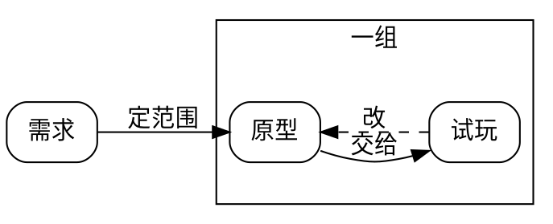

# graphviz（dot）

用 `dot -V` 确认当前命令可用。

## 用法

```bash
dot -Tpng 图.dot -o 图.png      # 出 png，用 read_image 看
dot -Tsvg 图.dot -o 图.svg      # 出 svg，能嵌进网页
```

## 最小可用模板



## 坑

- 中文渲染依赖当前可用字体；预览若缺字，为图、节点和边指定支持中文的 `fontname`。
- **查版本是 `dot -V`，而且走 stderr** —— 用 stdout 判断它在不在会判错。
- 节点名里有空格或标点要加引号：`"节点 一" -> "节点 二"`。
- 图大了会摊得很宽，`rankdir=LR` 和 `subgraph cluster_` 是收拾版面的两个主要手段。
