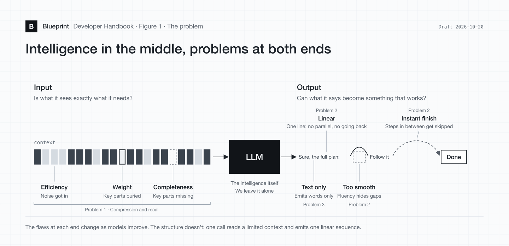
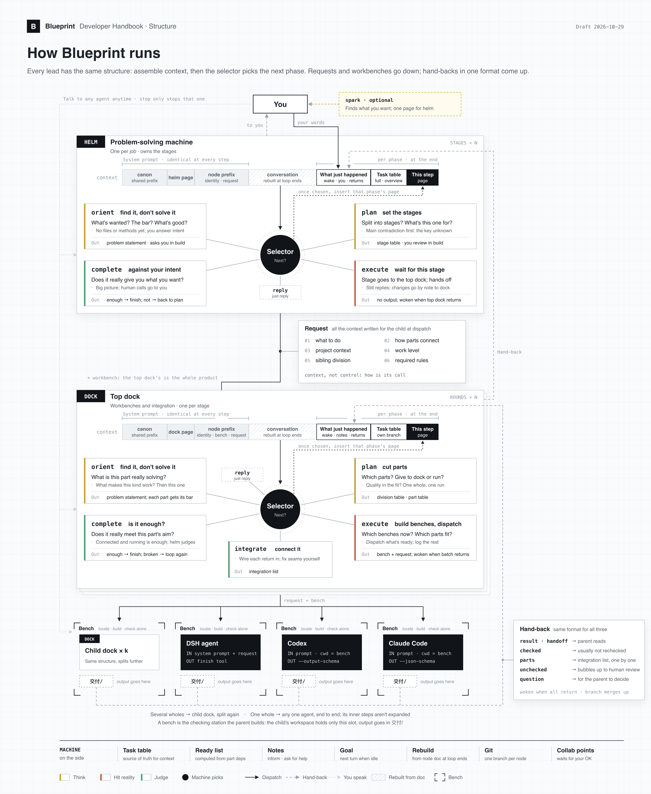

# Blueprint Developer Handbook

For people who want to build Blueprint with me. If you only want to use it, start with the [User Guide](user-guide.md).

> Release edition, 2026-10-29. The outline and the quoted lines are the designer's own words, translated from Chinese. The rest was written up by Claude from the designer's intent, with the facts checked against the current prompts and code.

> "We don't doubt any of an LLM's intuitions. We only doubt whether it got enough context, and an effective enough structure for its output."
>
> 2026-08-10, day 14 of building Blueprint

The prompts, many file names and most code comments are in Chinese. So is [app/README.md](../app/README.md). Paths below are written as they are in the repo.

---

## It all comes from one hypothesis

Given enough context, today's AI intuition is almost never wrong.

The contradiction is that intuition this good still can't organize the structure needed to get a complex, multi-step job done.

The chat box format limits what a model can take in and put out.

---

## The three problems the system has to solve

1. Efficient multi-level context compression and recall.
2. Effectively unfolding the hidden structure in time and space inside a complex task.
3. Multimodal eyes and hands, beyond a one-dimensional sequence of text.

---

## How Blueprint does it

> A visual cockpit: you can see the process and the results.
>
> A general problem compiler: it thinks problems through and breaks them apart.
>
> A multi-node information system: it remembers what matters and passes it on accurately.

Blueprint is a set of plugins on top of [dsh](https://github.com/deepseek-ai/deepseek-harness) (DeepSeek Harness, engine pinned at `0.2.1-alpha.2`). Model calls, tools, sub-sessions, compaction and Goal continuation are all native dsh. The few necessary engine patches are in [app/patches/](../app/patches/). The code is plain JavaScript with no build step.

The three kinds of node: **helm** is the Lead Producer in the interface, **dock** is a lead, and **run** is a Task specialist.

Each method below lists three things: how it works now, what's still missing, and where it is in the repo. In paths, `packages/` means `blueprint/packages/` and `重置/` means `blueprint/packages/prompt/重置/`.

### 1. Efficient multi-level context compression and recall

Compression means each piece of context keeps only what's needed to carry on. Recall means what's been saved can be found again when it's needed.

**Inside a node**

- **Rebuilding from the node document:** each node has one working document with four sections: request, duties, structure and record. After a stage report, when all direct children have handed back, and when the request is rewritten, the machine rebuilds the context from this document instead of asking the model to summarize its history. The original session stays in the dsh ledger. Helm and dock aren't compacted automatically by size. Past 500k tokens they get a one-line reading for every further 100k, and the node decides whether to `compact`. Run follows dsh's default compaction.
  - Missing: one run turn can be hundreds of steps, and rebuilding at loop boundaries doesn't reach it. In two real runs of the third version, the median context a run re-read per step was still 140k to 180k tokens.
  - Repo: `packages/node/src/上下文重建.js`, `packages/roster/`
- **System prompt stays identical:** canon, shared prefix, usage context, node page and node prefix (identity, node document entry, workbench, request) are the same word for word at every step. Anything that changes only gets appended at the end, so the cache keeps hitting. Each time a node enters a phase, one block is appended: what just happened (wake-up, notes, the user's words) → opening (duties, help requests still owed, lessons entry) → task table → the page for this phase, closest to what the model is about to say.
  - Repo: `packages/context/`, `packages/node/src/思考开头.js`. When each text appears is in [重置/README.md](../blueprint/packages/prompt/重置/README.md)
- **Entry archive:** web pages and long results it has read are stored as originals. Only a snippet and a path stay in view.
  - Repo: `packages/node/src/资料.js`

**Between nodes**

- **Context, not control:** dispatching uses the same six items everywhere: what to do, how the parts connect, project context, work level, division among siblings, and required rules. Give only what the other side can't get on its own, and leave the how to whoever takes it on.
  - Repo: `重置/请求/`, `重置/canon.md`
- **One format for hand-backs:** result, handoff, checked, unchecked, question, parts. DeepSeek uses the `finish` tool. Codex and Claude Code are held to the same format by a schema on the command line. Parts go into the parent's integration list. What a child has verified, the parent normally treats as settled and doesn't re-verify.
  - Missing: verification is still the biggest cost. In the third version's first run it was 40% of dock spend and 48% of run spend.
  - Repo: `重置/工具/finish.md`, `packages/node/src/外部run.js`
- **Notes:** an inform note needs no reply, and the sender carries on. A help request must be answered, and the sender stops until the reply arrives. A note is at most 2000 characters. Materials are passed as entries only.
  - Repo: `packages/node/src/纸条.js`, `packages/roster/`

**Across the project**

- **Two maps:** the task table has one row per node and is the only source of truth for tasks. It lives in the project's `系统文档/任务.db`, and only `divide` writes to it. The asset catalog is generated when things are shelved with `shelve`: anything fetched says why it was fetched, and the machine makes an inside page (thumbnail sheets, video frames, file trees, document outlines). Nodes normally read only the catalog and open originals when needed.
  - Repo: `packages/roster/`, `packages/node/src/上架.js`, `素材目录.js`, `素材内页.js`
- **Project lessons:** lessons written at hand-back are one file each in the project's `经验/`. Nodes that wake up later see the titles and entries.
  - Missing: they stay in one project, and nothing sorts, merges or retires them as they pile up.
  - Repo: `packages/node/src/交回记忆.js`
- **Pull, don't push:** skills, node documents, the asset catalog and lessons are all given as entries only. A skill is a folder with a `SKILL.md` describing how one trade does its work. There are more than twenty, and a node reads the one it needs.
  - Missing: few of them cover how a trade thinks and judges quality. How much the skills help has barely been verified.
  - Repo: `packages/prompt/skill/`, `packages/prompt/能力依赖.json`

### 2. A structure in time and space for the hidden production process

Work out the hidden steps first, then test them against real things. The structure that comes out of that is carried by a tree of nodes. All the model text is in `重置/`. The current shape (the third version) was set on 10-24 and has had several real runs since. The collaboration settings and the alignment of run with dsh, changed after 10-28, have passed tests but haven't had a real run.

**Unfolding**

- **The selector:** before a node enters each phase, the machine makes one model call outside the conversation. It sends exactly the context the node is about to send and asks only "What should be done next?" The answer is a phase name, and that phase's page is appended at the end. Helm's menu is orient, plan, execute, complete and reply; dock adds integrate. The order isn't fixed, and skipping one isn't an error. If the choice was wrong, the node writes `wrong_stage` and chooses again. Run doesn't go through the selector.
  - Repo: `packages/node/src/选择机.js`, `重置/选择机.md`. Each choice is logged in the project's `系统文档/选择机.jsonl`
- **Orient finds the problem, it doesn't solve it:** first, no reading files and no thinking about methods. Think about what makes this kind of thing work, then look at this particular one, and end with a problem statement.
  - Repo: `重置/阶段/orient.md`, `重置/阶段/helm/orient.md`
- **Spark:** planning at the very start. Show first, then ask: give a set of things that are far apart, ask which two are closer and which kind you least want to see, turn the user's stated wish into the structure underneath, and write it as one page for helm.
  - Repo: `重置/节点/spark.md`
- **Effort tiers and work levels:** a project picks high, max or ultra. That governs how big the pieces are, when something counts as done, how far up a clash with reality can overturn things, and how many versions to try. Each piece is dispatched with a work level of stunning, polished or lean, and a run gets a matching page when it starts.
  - Missing: the first ultra run on 10-27 cut stages by problem and had the first round's three pieces compete in parallel, which was very different from high. But the prompts and workers changed at the same time, so the effect of the tier alone hasn't been measured.
  - Repo: `packages/prompt/shells/档位/`, `重置/run开工/`

**Time**

- **Helm splits into stages:** helm is a problem-solving machine, one per job. Plan decides whether to split into stages and what this stage answers, tackling the main contradiction first: the unknown most able to change later decisions. Each stage gets a brand-new top dock, and helm stays out of it during execute. Complete looks at the whole against the user's intent: if it's satisfied it closes, and if not it goes back to plan for the next stage.
  - Repo: `重置/阶段/helm/`, `packages/node/src/阶段排期.js`
- **Dock splits into rounds:** it dispatches the batch its workbenches can support first. Pieces with missing dependencies are only registered in the task table and judged next round. The machine computes a ready list from dependencies, and dock is woken once, only when the whole batch has handed back.
  - Repo: `重置/阶段/execute.md`, `packages/node/src/策略.js`, `等待依赖.js`
- **Judging the gap:** complete compares the result with the original purpose, not with its own design. At the dock level, connected and running is enough, and helm judges the overall effect. Only if it doesn't connect does it go round again.
  - Missing: in the third version's first run, one scene piece looked at 82 images and still judged itself done, with a hard seam right across the middle of the sky. Looking more doesn't mean seeing better.
  - Repo: `重置/阶段/complete.md`, `重置/阶段/helm/complete.md`

**Space**

- **One whole or several:** things whose quality lies in how they work together are one whole and go to one run, end to end. Things whose quality lies in each one and that connect only through clear interfaces are several, and go to a dock to split further. There are no fixed roles like "art" or "engineering". What each layer splits into grows from the job at that layer.
  - Missing: the third version's first run had a dock layer that dispatched only one child and passed the task along almost unchanged. Plan now says "if the cut gives only one piece, do it yourself", which still needs a real run to confirm.
  - Repo: `重置/节点/`, `重置/阶段/plan.md`, `packages/node/src/组织设计.js`
- **Workbench:** the parent sets up a directory `验收台/<piece>/` for each piece. Only that directory is checked out in the child's workspace, and the output goes in its `交付/`. A workbench has to be locatable, buildable alone and checkable alone. It holds no stand-ins for other pieces and none of the answers the parent has in mind.
  - Missing: isolation relies only on the checkout. With an absolute path, a node can still see other workbenches.
  - Repo: `packages/node/src/节点Git空间.js`, `重置/阶段/execute.md`
- **Integration:** integrate wires what's handed in into the product one by one and adjusts the seams itself. The integration list has a row per child part, each marked as connected, not connected, or left for someone. The top dock's workspace is the whole product, and everything has to run there once it's all connected.
  - Missing: in one real run on the Mac mini, the character art and scene art lines both made the ground and props, and the extra branch took about 14% of the project's cost. Requests now include "division among siblings", which still needs a real run to confirm.
  - Repo: `重置/阶段/integrate.md`
- **One branch per node:** each node has a Git branch and worktree growing from its parent's branch, and merges upward at hand-back. If there's a conflict, the hand-back doesn't count, and the node resolves it itself.
  - Repo: `packages/node/src/节点Git空间.js`
- **Run is an ordinary agent:** a DeepSeek run works like dsh's own chat, with todos, plan mode, fork, subagents and question cards, and compacts the dsh default way. A piece can also go to Codex or Claude Code on the user's computer. External agents only ever act as runs.
  - Missing: external agents are one-shot and can't resume the same session. Carrying on means starting a new one.
  - Repo: `blueprint/agent.cordis.yml`, `packages/node/src/外部run.js`, `重置/外部run.md`
- **Cockpit:** draws this tree, one card per node, where color is status and you can switch by round. Open any one to see its task, status, output and reports, and talk to it directly. Stopping stops only that one, and talking to it lets it continue. Collaboration settings are a table: Lead Producer and parts × start, plan and check. Ticked means wait for a person, off means go ahead. A system notification appears when a person needs to answer.
  - Missing: there are still many useful components not built.
  - Repo: `packages/canvas/`, `layout/`, `studio/`; `packages/node/src/协作设置.js`

### 3. Multimodal eyes and hands, beyond a one-dimensional sequence of text

**Eyes**

- **Direct multimodal reading:** if the model can see images, the original goes straight to it. What it can't see or hear goes through media services to be understood or transcribed.
- **Looking at the real output:** `render_page` uses the browser bundled with the app to screenshot web pages, HTML and SVG, and `read_image` then looks at what was actually made. When a node opens Chrome from a command, that also becomes the bundled headless build.
  - Repo: `packages/prompt/工具/render_page.md`, `packages/node/src/网页截图.js`
- **Overview sheets:** a batch of images becomes one numbered overview, and sound gets a listening page, so a choice takes one look.
- **Web search:** `web_search` looks things up without a search key, and `web_fetch` reads the source.

**Hands**

- **Media service catalog:** the user connects image, video and audio services (OpenAI, Gemini, fal, SiliconFlow and others) and ticks what each actually supports. Nodes discover and call them as tasks need.
  - Missing: SiliconFlow's dedicated video and audio protocols aren't adapted, and dedicated protocols each need their own adapter. The cost total at the top doesn't count media calls.
  - Repo: `packages/media/`, `packages/node/src/媒体服务.js`, `媒体工具.js`
- **Skill-driven tools:** Blender, Godot, Phaser, Three.js, FFmpeg, ImageMagick, Typst, Word, Excel, PowerPoint and others. Nodes work and check by the methods in the skills. Commands run inside the project, with project isolation.
  - Repo: `packages/prompt/skill/`
- **Software page:** checks which common programs this Mac has and installs missing ones in the background with Homebrew in one click.
  - Repo: `packages/media/`
- **Fetching assets:** search, pick and fetch from Poly Haven, ambientCG, Iconify, Wikimedia Commons, itch and others, with sources and licenses recorded automatically.
  - Missing: Sketchfab downloads need a login token, and no original has been fetched that way yet. Keyed requests to Freesound and Jamendo haven't been verified. Good sources for music, sound effects and character animation are still few.
  - Repo: `packages/prompt/skill/resource-reuse/`
- **External agents as hands:** turn on Codex or Claude Code in Agent choice and write what work should go to them first, and docks will consider them when dispatching.
  - Repo: `packages/node/src/子代理开关.js`, `packages/media/`

---

## Thoughts on where this goes

These are my current ideas, and they're incomplete. If you have better context, you make the call.

**1. One entry point and one bill for multimodal, multi-domain APIs, so every task gets the best-value model**

Right now users connect and choose chat models and media services themselves. I want one entry point to every model and service, billed together, that automatically picks the best value for each task.

**2. More hands and eyes, including more efficient visual and spatial models**

It still can't click, fill in and drag on web pages the way a person does, or control other desktop apps (the playwright-cli and peekaboo skills are in the package but not wired in yet). HTML animations can't yet be exported as complete MP4s with audio. 3D and games need better spatial understanding.

**3. Better lessons and memory**

As lessons pile up, they need sorting, merging and retiring, and they need to travel between projects.

**4. Better underlying architecture**

Most of the money and time goes to reading and verifying. With dozens of nodes running in parallel, they should stop re-reading and re-verifying. When a loop judges a result not good enough, it should learn to turn back and try another road instead of patching the same one. And long tasks and restarts should pick up cleanly.

---

## This is a hypothesis, not a conclusion

All of this is my hypothesis and how I'm testing it. Some of it has had real runs, and some was only just written and hasn't run. This handbook says plainly what's done and what's missing.

If these problems have tormented you too, come help test it.

- **Repo:** [github.com/wbohui123-sys/blueprint](https://github.com/wbohui123-sys/blueprint)
- **Run it:** an Apple Silicon Mac and Node 22.19 or later. From the repo root, `npm --prefix app ci`, then `npm --prefix app start`. Packaging and tests are in [app/README.md](../app/README.md). Offline tests use a mock model, so passing them doesn't mean real runs go well, and some tests are currently out of date and fail.
- **Model text:** it's all in `重置/`, and in Chinese. Please don't change the sentences I wrote except for typos and grammar. To add something, add another sentence, or ask me first.

The license is AGPL-3.0: see [LICENSE](../LICENSE).

Contact me: [wbohui123@gmail.com](mailto:wbohui123@gmail.com) · [Issues](https://github.com/wbohui123-sys/blueprint/issues)
